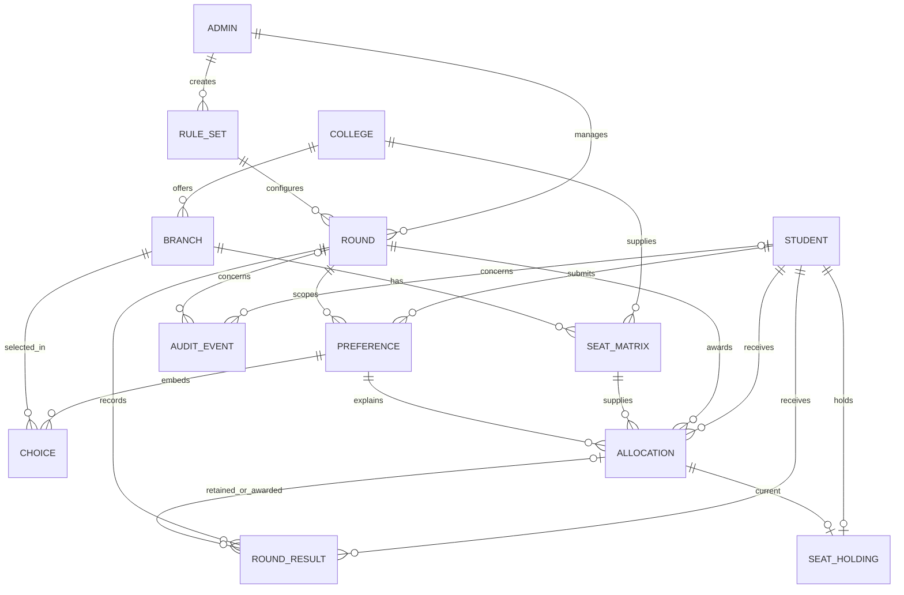

# CounselDesk schema

All collections use ObjectId `_id`, `createdAt`, `updatedAt` and Mongoose `__v`.
All top-level models reject unknown fields. Optimistic concurrency applies to
document `save()` operations; it does not make arbitrary query updates safe.
`academicYear` is the starting year as an integer, e.g. `2026` for 2026–27.

## Relationships



`CHOICE` is an embedded subdocument, not a collection. Its `_id` replaces the
diagram's individual `pref_id`. The parent Preference `_id` identifies the list.
A retained earlier allocation may appear in later RoundResults without creating
another allocation or decrementing a seat again.

## Data dictionary

Fields are required unless marked optional or defaulted. References identify
records, not embedded copies. E1 services enforce reference existence and consistency.

| Model / collection | Fields and meaning |
| --- | --- |
| Student / students | applicationNumber (CET/application code), academicYear, name, dateOfBirth (past), email (normalized), passwordHash (encoded bcrypt/Argon2id, hidden), rank (positive integer), category (code); eligibilityGroups defaults []; verificationStatus defaults PENDING; status defaults REGISTERED |
| Admin / admins | name, email, passwordHash; role defaults COUNSELLING_ADMIN; status defaults ACTIVE |
| College / colleges | collegeCode, name, location, type (GOVERNMENT/AIDED/PRIVATE); optional HTTP(S) website; isActive defaults true |
| Branch / branches | college reference, name, programCode, programType, department, durationYears (integer 1–8); isActive defaults true |
| RuleSet / rule_sets | academicYear, version, name, createdBy Admin; ordered nonempty seatCategories with category, nonempty distinct allowedStudentCategories, requiredEligibilityGroups default [], requiresVerification default true |
| Round / rounds | academicYear, roundNumber, name, managedBy Admin, ruleSet reference, startDate, preferenceDeadline, endDate; status defaults DRAFT; allowUpgrade/allowRelease default true; optional publishedAt, required exactly when PUBLISHED |
| SeatMatrix / seat_matrices | academicYear, college, branch, category, totalSeats, availableSeats; counts are nonnegative safe integers and availableSeats <= totalSeats |
| Preference / preferences | student, round, academicYear; choices default []; each choice contains college, branch, preferenceOrder and an ObjectId; locked defaults false; optional submittedAt/lockedAt, both required for locked lists |
| Allocation / allocations | student, round, academicYear, seatMatrix, preference, preferenceOrder, rankSnapshot; status defaults ALLOTTED; allocatedAt defaults now; optional previousAllocation for successful upgrades |
| RoundResult / round_results | student, round, academicYear, outcome (ALLOTTED/UNALLOCATED/FAILED), reason; allocation required exactly for ALLOTTED; processedAt defaults now |
| AuditEvent / audit_events | action, actorType (Student/Admin/SYSTEM), requestId, summary; actor id required for human actors and forbidden for SYSTEM; optional academicYear/student/round/allocation; occurredAt defaults now |
| SeatHolding / seat_holdings | student, academicYear, allocation; one current holding per student/year |
| CounsellingCycle / counselling_cycles | academicYear; revision defaults 0 and serializes year mutations |

Names and codes are trimmed. Codes are uppercase, at most 40 characters, and
contain letters, digits, hyphens or underscores. Category values come from rule
data, not a hard-coded list of assumed official reservations. Enrollment ranks
are supplied before phase 1 student records are created; a registration flow that
precedes rank availability will need a separate application intake design.

## Indexes and invariants

| Collection | Unique boundary | Additional indexes |
| --- | --- | --- |
| students | year + applicationNumber; year + email; year + rank | year + status + rank |
| admins | email | — |
| colleges | collegeCode | location + type |
| branches | college + programCode | — |
| rule_sets | year + version | — |
| rounds | year + roundNumber | year + status |
| seat_matrices | year + branch + category | year + college + category |
| preferences | student + round | round + locked + student |
| allocations | student + round | student + year + status; seatMatrix + status; round + status |
| seat_holdings | student + year; allocation | — |
| counselling_cycles | year | — |
| round_results | student + round | round + outcome |
| audit_events | none (one request can produce several events) | student + occurredAt; round + occurredAt; requestId |

Holding statuses are ALLOTTED, ACCEPTED and UPGRADE_REQUESTED. RELEASED, UPGRADED
and CANCELLED preserve history. SeatHolding identifies the single current seat.
An upgrade updates this pointer in place while creating a new allocation and
marking the old allocation UPGRADED in one transaction. Initialization backfills
holdings and retires the former partial unique Allocation index. Services update
both the holding and pool counts atomically.

A seat pool is shared by all rounds in a year. Do not reset availableSeats at the
start of a new round. The enforced service invariant is:

```text
availableSeats = totalSeats - count(holding allocations for that seat pool)
```

Mongoose validates capacity on document validation; `db:init` also installs a
MongoDB validator for integral nonnegative counts and `availableSeats <= totalSeats`.
E1 transactions preserve equality with allocations; reconciliation reports drift.

## Service checks

Mongoose `ref` enables population, not foreign keys. Before any mutation, services
must check all references in the same session as the write:

1. Branch belongs to the specified college; catalogue records exist and are active.
2. Student, round, rules, preference, seat pool and allocation share the academic year.
3. The chosen pool category exists in the round's RuleSet and the verified student
   meets its category/group requirements in configured precedence order.
4. Preference belongs to the student/round, is locked and contains the allocated
   college/branch at the stored preferenceOrder. rankSnapshot matches the candidate.
5. Edits and locks obey the round window. Once locked, choices never change.
   A new-round list is a new document. Reordering must replace the entire list
   with optimistic version checking; do not patch array positions independently.
6. An upgrade's previousAllocation belongs to the same student/year, is the held
   seat, is from an earlier round and is superseded atomically. Retained results
   may reference an earlier allocation but never a different student's allocation.
7. Round state transitions, publication completeness and decision windows are valid.
   A published round cannot contain unfinished or failed jobs.
8. Audit records use a trusted authenticated actor and are append-only; summaries
   never contain passwords, connection strings, document contents or payment data.
9. Rules and capacities used by processing/published rounds are frozen. Rule changes
   create a new version for a later round; historical records are not rewritten.
10. Deletes do not orphan references. Prefer deactivation of catalogue records and
    keep allocation/history records. No cascading delete is implemented.

Do not rely on `updateOne`, `findOneAndUpdate`, `bulkWrite`, raw collection writes
or `runValidators: true` to execute these cross-document rules. Query validators
and document hooks differ. No generic public write API is exposed in this phase.

## MongoDB transaction contract

Use a replica-set session and a retryable transaction. Re-read the authoritative
pool and conditionally decrement where `availableSeats > 0`; check matched counts.
Perform all allocation, result, student and audit changes in that same session.
Retries must repeat the whole transaction safely, with no external side effects
inside retryable callbacks. Database uniqueness provides a final duplicate barrier,
while the service must return the prior result for a replayed job.

E1 rejects out-of-order jobs and rechecks proposed seats before committing.
Pool updates use fixed ObjectId order. CounsellingCycle serializes transactions
per academic year across processes. E2 owns worker scheduling and bounded job
retries. MongoDB transaction conflicts replace the documents' SQL row-lock model.

## Validation status

Offline tests cover models, configuration, seeds and helpers. Atlas integration
tests verify database uniqueness/validation, reference and ownership checks,
rollback after injected failures, repeated requests, rank ordering, release,
upgrade and retention across three rounds. The 10,000-student/500-user load targets
have not been measured. See [the service guide](dbms-services.md) for usage.
